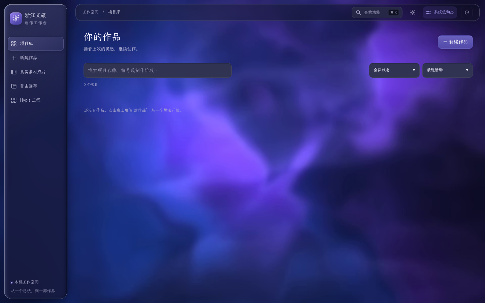
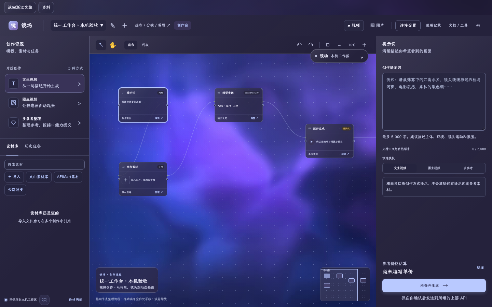

# 浙江文旅工作台

**让资料、脚本、画布、分镜和成片，在一个玻璃工作区里继续创作。**

作者与维护：[ll9999345](https://github.com/ll9999345)。本仓库将浙江文旅智能导演与镜场 Agent 合并管理，保留各自的编辑、任务与媒体能力，以一个本机入口使用。代码公开不包含作者的作品素材、私人项目、密钥、模型权重或本机运行环境。

> 项目整合了开源组件与自有实现。各工具的“有代码、已接入、测试通过、实际本机运行、真实云/GPU验证”是不同状态；当前不宣称所有参考项目已一比一复刻。

## 可以做什么

| 工作区 | 主要能力 |
| --- | --- |
| 文旅导演 | 项目管理、创作方案、脚本与分镜、任务进度、历史与媒体结果 |
| 真实素材成片 | 多来源素材检索、审核选片、配音/配乐、字幕与本机合成 |
| 镜场自由画布 | 文字/图片/视频/音频节点、连线、分组、循环、拖放与跨工程粘贴 |
| 镜场创作台 | 视频/图片生成参数、参考素材、任务查询、结果回填与版本留痕 |
| 模型与工作流 | 已适配的 Seedance、MiniMax/Hailuo、图片接口、RunningHub、ComfyUI 等接入方式 |
| Hypit 工程 | 固定版本原生工程、示例另存、Check/Plan/Build、输出检查/导出/预览与已知旧工程迁移 |
| 本机中文语音 | 已有模型就绪后，CPU 识别、中文逐字对齐、字幕合成与工作台语音服务管理 |
| 工具与恢复 | 素材库、提示词库、图像处理、剪辑导出、任务恢复和工程/素材库备份 |

所有功能页沿用同一套玻璃视觉。减少动态效果时仍保留可读的静态表面；实际流畅度取决于浏览器与硬件。

## 界面预览





## 安装与启动

需要 **Python 3.12+、Node.js 24、FFmpeg/FFprobe**。现有电脑上的原始工程不需要为使用本仓库而删除或搬走。

```bash
git clone https://github.com/ll9999345/zhejiang-jingchang-workbench.git
cd zhejiang-jingchang-workbench
python3 -m venv .venv
.venv/bin/python -m pip install -r requirements.txt
npm ci --prefix apps/jingchang
.venv/bin/python scripts/start_workbench.py
```

打开 **http://127.0.0.1:4750**。请通过这个网址进入，不要双击 `backlot/ui/` 下的 HTML 文件；直接打开文件无法连接样式资源与本机接口。主入口包含文旅、真实素材成片、镜场画布与各创作工具；镜场服务默认在本机 4768 端口运行。

如默认端口已被其他实例使用，请改用一组空闲端口：

```bash
.venv/bin/python scripts/start_workbench.py --port 4790 --canvas-port 4791
```

安装只包含基础依赖。Hypit、ASR、中文对齐、图像增强、本地 GPU 等可选运行时有独立依赖与模型；缺少时页面应显示未就绪，不能把安装基础依赖等同于全部功能可运行。字幕烧录需要带 `subtitles`/libass 的 FFmpeg；可用 `FOOTAGE_FFMPEG_PATH` 指定已有版本，启动不会替换系统工具。具体配置与本机验收边界见 [统一项目说明](docs/UNIFIED_WORKBENCH.md)。

## 模型、密钥与调用

- 复制 `.env.example` 为自己的 `.env`，或在对应连接设置中配置服务；不要把 `.env`、账号导出或用户数据提交到 Git。
- Seedance、MiniMax 等云模型需要提供方实际开放的型号、账号权限和可用额度；选项存在不代表当前账号已可调用。
- RunningHub 与 ComfyUI 保留各自工作流/接口能力，不把一个适配协议称为所有服务通用。
- Google Flow 会员与程序 API 的额度/计费相互独立；Flow 专用完整交接尚未完成。
- 付费生成及第三方素材发送需要明确的服务、预算与范围授权。安装和启动不会自动发起生成。
- 本机中文语音是明确标识的 CPU 兼容适配器，目前限中文、每段不超过 30 秒，不冒充完整官方 WhisperX 发行包。

## 数据与备份

默认本机工作数据保存在 `.local/`（启动后生成并被 Git 忽略）。原始文旅项目、镜场工程、生成历史和素材库仍由各自的数据模型管理，统一界面不会把所有工程强行转换成一种格式。

使用镜场的工程备份与素材库备份，并在导入时核对预览；两类备份范围不同。停止/恢复任务沿用原编号，不能用重新生成代替查询。大文件、实体设备、真实云端/GPU与跨机器恢复按各功能说明的实际验收范围使用。

## 目录

```text
backlot/            文旅工作台与统一玻璃界面
web_api/            本机接口、模块整合、任务和媒体处理
tools/              创作、分析、音频、渲染等工具
apps/jingchang/     镜场界面、服务、画布及工作流能力
integrations/       固定版本的第三方源码与接入代码
scripts/            统一启动及开发辅助脚本
tests/              文旅与整合测试
docs/               架构、使用、验收范围和来源说明
```

## 测试与开发

```bash
.venv/bin/python -m pytest web_api/tests -q
npm test --prefix apps/jingchang
node --test tests/backlot/hypit_workbench.test.cjs
```

部分测试需要可选依赖、浏览器、媒体工具或特定模型；没有这些条件不能把跳过或模拟返回当作真实模型验收。项目使用本机合成媒体、协议测试服务和真实浏览器分别验证界面与运行链路；真实供应商输出质量与账单需要独立验证。

## 来源与许可

本仓库的自有整合与扩展按根目录 [AGPL-3.0](LICENSE) 发布；第三方文件继续适用其原有许可证与署名要求，根许可证不覆盖第三方的独立限制。

- [OpenMontage](https://github.com/calesthio/OpenMontage)：原始视频创作工具与工作台基础。保留其版权、AGPL 许可及[原始说明](docs/upstream/OpenMontage.README.md)。
- [MoneyPrinterTurbo](https://github.com/harry0703/MoneyPrinterTurbo)：固定版本的隔离素材能力后端，保留 MIT 原文。
- [Hypit](https://github.com/hypit-ai/hypit)：固定版本工程与本机运行接入，遵循其自定义附加条件许可。
- [Infinite Canvas](https://github.com/hero8152/Infinite-Canvas)：镜场功能对照基准与部分规则参考，保留非商业/署名自定义许可归因，不能描述为 MIT。
- LibTV、Miao 等参考按具体来源说明区分交互参考、独立实现与实际接入；第三方产品名称不代表官方合作。

其余组件（Motion、GSAP、Three.js、Whisper/WhisperX、Piper、图像模型等）的版本、来源和独立许可见 [第三方说明](docs/THIRD_PARTY_NOTICES.md) 与各目录原文。模型代码许可不自动赋予第三方图片、音乐、视频的商用权。

## 本次整合验证（2026-10-31）

- 镜场全量首次检查：2,003项中1,966项通过；修正目录、测试资源和默认规则后，覆盖原37项失败的122项专项回归全部通过。没有把两次运行合称一次全量通过。
- 文旅/镜场交换、Hypit运行与语音管理：127项通过；旧版、新版两种素材规则均验证了本机导入、编辑、实际视频导出与取回。
- 14个入口在真实Chrome中打开，无脚本异常、资源/API失败或外部请求；390px Hypit页面无横向溢出。
- 以上使用本机合成测试媒体和隔离目录，不代表所有云模型、账号、本地GPU及可选运行时均已完成验收。详见[本次验收](docs/UNIFIED_ACCEPTANCE_20261031.md)。
